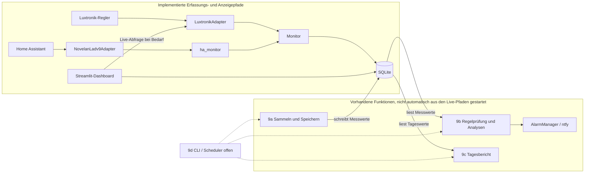

# Backlog – Issues zum Verteilen an Agenten

Jedes Issue ist so geschnitten, dass ein Agent es in einem PR erledigen kann.
**Parallel-Gruppe**: Issues derselben Gruppe berühren keine gemeinsamen Dateien und können gleichzeitig laufen.

Der Status bewertet den **im Repository vorhandenen Implementierungs- und Teststand**,
nicht Installation, Verfügbarkeit oder Betriebsreife eines Live-Systems. „Fertig“ bedeutet
hier: der beschriebene Codepfad ist vorhanden und durch Tests abgedeckt; reale
Regler-/Home-Assistant-Zugriffe und App-Deployment sind damit nicht nachgewiesen.

| # | Titel | Agent | Parallel-Gruppe | Abhängig von | Status und belegte Einschränkung |
|---|---|---|---|---|---|
| 1 | Spreizungs-Analyse | analyst | A | – | **fertig** – `analyse/spreizung.py`, `tests/test_spreizung.py`; Bewertung beruht auf den implementierten Richtwerten. |
| 2 | Adapter für meine Wärmepumpe | datensammler | A | – | **fertig** – Luxtronik- und Novelan/HA-Adapter mit Tests; reale Geräte-/HA-Verbindung nicht durch Tests belegt. Luxtronik liefert nur aktuelle Werte, keine Historie. |
| 3 | Heizstab- und Effizienz-Analyse | analyst | B | 1 | **fertig** – `analyse/effizienz.py`, `tests/test_effizienz.py`; AZ setzt geeignete Energie- und Außentemperaturwerte voraus. |
| 4 | Raumkomfort-Analyse | analyst | C | – | **fertig** – `analyse/komfort.py`, `tests/test_komfort.py`; tatsächliche Raumwerte und Sollwerte müssen bereitgestellt werden. |
| 5 | Simulation: Fehlerszenarien | tester | A | – | **fertig** – Szenarien und Tests in `simulation.py`, `tests/test_simulation.py`; Simulation ist kein Live-Nachweis. |
| 6 | Alarm-Grundgerüst mit Telegram/ntfy | alarm | B | – | **fertig** – `AlarmManager` und getesteter ntfy-Melder erfüllen das „und/oder“ im Issue; Telegram ist nicht implementiert. Die Alarmierung ist noch nicht mit einem gestarteten Gesamtprozess verdrahtet, Alarmzustand bleibt im Prozessspeicher. |
| 7 | SQLite-Speicher | datensammler | B | 2 | **fertig** – Speicher-API und Persistenztests vorhanden; der aktuelle Live-Datenbestand ist davon getrennt und hat noch das alte Schema (siehe Live-Verifikation unten). |
| 8 | Tagesbericht | analyst | – | 1, 3, 4 | **fertig** – Berichtsgenerator und Tests vorhanden; Datenqualität und Abdeckung begrenzen die Aussage des Berichts. |
| 9 | Dauerbetrieb (Scheduler: sammeln → analysieren → melden) | architekt → alle | – | 6, 7 | **teilweise** – Funktionen 9a–9c sind vorhanden; integrierter `wpanalyse.run`-Scheduler (9d) fehlt. `monitor`/`ha_monitor` pollen und speichern, führen aber nicht den vollständigen Ablauf aus. |
| 9a | Sammeln und Speichern orchestrieren | datensammler | D | 2, 7 | **fertig** – `erfassung.py`, `tests/test_erfassung.py`; keine eigene Zeitplanung (wie vorgesehen). |
| 9b | Regelprüfung und Alarmierung orchestrieren | alarm | D | 1, 3, 4, 6, 7 | **fertig** – `monitoring.py`, `tests/test_monitoring.py`; wird noch nicht durch einen Gesamt-Scheduler regelmäßig gestartet. |
| 9c | Tagesbericht aus dem Speicher erzeugen | analyst | D | 7, 8 | **fertig** – `tageslauf.py`, `tests/test_tageslauf.py`; wird noch nicht durch einen Gesamt-Scheduler täglich gestartet. |
| 9d | CLI und Scheduler integrieren | architekt | – | 9a, 9b, 9c | **offen** – `src/wpanalyse/run.py` und `tests/test_run.py` sind nicht vorhanden; kein integrierter Scheduler für 9a–9c. |
| 10 | Dashboard (Streamlit) | analyst | – | 7 | **fertig** – Dashboard-Code und Hilfsfunktionstests vorhanden; Live-Reglerzugriff mit Streamlit am 07.11.2026 erfolgreich geprüft. Dauerbetrieb ist nicht validiert. |
| 11 | Luxtronik-CSV: Feldinventur und fokussierter Import | datensammler | – | – | **teilweise** – generischer `CsvAdapter` existiert; die geforderte `mappe_luxtronik_csv`-Feldzuordnung (inkl. namenloser Zeitspalte) und CSV-spezifische Tests fehlen. |
| 12 | SQLite-Kernschema für Anlagen und Messwerte | datensammler | – | bestehender SQLite-Speicher | **fertig im Code** – Zieltabellen und Migration in `speicher/sqlite.py`; ein Migrationstest ist in `tests/test_sqlite_speicher.py` vorhanden, aber pytest wurde hier nicht ausgeführt (in der Projektumgebung nicht verfügbar). Die vorhandene `data/wp.sqlite` ist noch nicht migriert; vor dem ersten Öffnen mit dem aktuellen Speicher sichern. |
| 13 | Raumtemperaturen relational speichern | datensammler | – | 12 | **teilweise** – relationale Raumwerte und Tests vorhanden; umgesetzt über `speichern`/`lese_raum_messwerte` statt der im Issue benannten Methoden `speichere_raeume`/`lese_raeume`; Live-DB noch im Altschema. |
| 14 | Störungs- und Wartungsereignisse speichern | datensammler | – | 13 | **teilweise** – Speicherung, Bereichsabfragen und Tests vorhanden; die Methoden heißen `speichern_stoerung`/`speichern_wartung_reparatur` statt der im Issue benannten Schnittstellen. Tatsächliche Ereignisdaten und Live-Migration sind nicht nachgewiesen. |

#### Zusammenspiel der Teilbereiche

Durchgezogene Pfeile zeigen implementierte Pfade und Funktionsaufrufe; die getrennte
Darstellung macht sichtbar, dass die Analyse-/Berichtsfunktionen nicht automatisch aus den
Erfassungspfaden gestartet werden. Gestrichelte Scheduler-Pfeile markieren die noch offene
zeitgesteuerte Integration.

#### Live-Verifikation (07.11.2026)

Die vorhandene `data/wp.sqlite` wurde **nur lesend** geprüft: 58 Messungen, `PRAGMA
integrity_check` ergibt `ok`, und es gibt 5 Abstände von mehr als 90 Sekunden. Der
Live-Reglerzugriff über das Streamlit-Dashboard wurde am 07.11.2026 erfolgreich getestet;
ein durchgehender oder längerfristiger Dauerbetrieb ist damit nicht validiert. Die Datei
enthält weiterhin ausschließlich das alte Schema `messwerte(zeit_ns, daten)` und
`metadaten`; die neuen Tabellen `anlage` und `messwert` fehlen. Die Migration ist zwar
im aktuellen SQLite-Speichercode implementiert; ein Test mit einer synthetischen
Testdatenbank ist vorhanden, wurde hier mangels pytest in der Projektumgebung aber nicht
ausgeführt. An dieser Live-Datei ist die Migration noch nicht erfolgt. **Vor jedem Öffnen mit dem
aktuellen `SQLiteSpeicher` unbedingt eine Sicherungskopie erstellen**, da dessen
Initialisierung die Migration automatisch ausführt. Diese Prüfung belegt weder
ununterbrochenen Betrieb noch die Verfügbarkeit einer externen Quelle oder Betriebsreife.

---

### Issue 1 – Spreizungs-Analyse
**Ziel:** `src/wpanalyse/analyse/spreizung.py` mit `analysiere_spreizung(df, cfg) -> SpreizungErgebnis`.
**Akzeptanz:** mittlere Spreizung nur bei laufendem Verdichter; Regel A3 aus `fachwissen.md`; Bewertung + Klartext; Tests für Normalfall und „verschmutzter Filter“.
**Muster:** `analyse/taktung.py`.

### Issue 2 – Adapter für meine Wärmepumpe
**Ziel:** neuer Adapter in `src/wpanalyse/adapters/` für *(Marke/Modell/Schnittstelle eintragen, z. B. Home Assistant REST-API)*.
**Akzeptanz:** implementiert `DatenAdapter`; Zugangsdaten aus Umgebungsvariablen, `.env.example` ergänzt; Mapping der Herstellerfelder auf `fachwissen.md`-Felder dokumentiert; Tests mit gemockten Antworten.

### Issue 3 – Heizstab- und Effizienz-Analyse
**Ziel:** `analyse/effizienz.py` – Tages-AZ, Bewertung abhängig von Außentemperatur (A2), Heizstab-Regel (A4).
**Akzeptanz:** funktioniert auch ohne `waerme_kwh` (dann nur Heizstab-Regel und Hinweis „AZ nicht berechenbar“).

### Issue 4 – Raumkomfort-Analyse
**Ziel:** `analyse/komfort.py` – je Raum Anteil Zeit unter Soll, Regeln A5/A6, kältester Raum, Hinweis auf hydraulischen Abgleich.
**Akzeptanz:** Raum-Sollwerte aus `config.py`; beliebig viele `raum_*_c`-Spalten.

### Issue 5 – Simulation: Fehlerszenarien
**Ziel:** `simulation.py` um Szenarien erweitern: `filter_verschmutzt`, `heizstab_mild`, `raum_kalt`, `datenluecke`, `stoerung`.
**Akzeptanz:** jedes Szenario per Parameter aktivierbar; Tests prüfen, dass das Szenario in den Daten sichtbar ist.

### Issue 6 – Alarm-Grundgerüst
**Ziel:** `src/wpanalyse/alarm/` mit `Melder`-Interface, `NtfyMelder` und/oder `TelegramMelder`, Entprellung (gleiche Meldung max. 1×/6 h), Entwarnung.
**Akzeptanz:** Tests mit `FakeMelder`.

### Issue 7 – SQLite-Speicher
**Ziel:** `src/wpanalyse/speicher/` – Messwerte speichern/laden als DataFrame für Zeitraum.

### Issue 8 – Tagesbericht
**Ziel:** Text/Markdown-Bericht: AZ, Starts, Laufzeit, Spreizung, Komfort je Raum, Auffälligkeiten – verständlich für Laien.

### Issue 9 – Dauerbetrieb
**Ziel:** Kommando `python -m wpanalyse.run`: alle X Minuten sammeln, alle 15 min Regeln prüfen und täglich einen Bericht erzeugen. Das Issue ist in 9a–9d zerlegt; 9a–9c können parallel bearbeitet werden. Docker-Betrieb (z. B. auf Raspberry Pi / NAS) bleibt späteren Issues vorbehalten.

#### Teil-Issue 9a – Sammeln und Speichern orchestrieren
**Agent:** datensammler
**Ziel:** Adapter und Speicher für einen Sammellauf verbinden, ohne den Scheduler vorwegzunehmen.
**Betroffene Dateien:** `src/wpanalyse/erfassung.py`, `tests/test_erfassung.py`.
**Schnittstelle:** `sammle_und_speichere(adapter: DatenAdapter, speicher: SQLiteSpeicher, von: datetime, bis: datetime) -> pd.DataFrame`.
**Akzeptanzkriterien:**
- Ruft den Adapter für den halboffenen Zeitraum `[von, bis)` auf und speichert das Ergebnis unverändert im Speicher.
- Gibt die gesammelten Messwerte zurück, damit Aufrufer den Lauf nachvollziehen können.
- Adapter- und Speicherfehler werden nicht verschluckt oder als erfolgreicher Lauf ausgegeben.
- Die Funktion enthält keine eigene Zeitplanung.
**Testidee:** Mit Fake-Adapter und SQLite-Testdaten prüfen, dass Zeitraum, zurückgegebener DataFrame und gespeicherte Messwerte übereinstimmen; Fehler des Adapters werden weitergereicht.

#### Teil-Issue 9b – Regelprüfung und Alarmierung orchestrieren
**Agent:** alarm
**Ziel:** Gespeicherte Messwerte durch die bestehenden Analysen führen und den vollständigen Befundstand an den Alarmmanager übergeben.
**Betroffene Dateien:** `src/wpanalyse/monitoring.py`, `tests/test_monitoring.py`.
**Schnittstelle:** `pruefe_und_melde(speicher: SQLiteSpeicher, alarm_manager: AlarmManager, cfg: Config, von: datetime, bis: datetime) -> list[Befund]`.
**Akzeptanzkriterien:**
- Liest den angefragten Zeitraum und führt Taktungs-, Effizienz-, Spreizungs- und Komfortanalyse aus.
- Übergibt alle aktuellen Befunde gesammelt genau einmal an `AlarmManager.verarbeite`, auch wenn die Liste leer ist, damit Entwarnungen funktionieren.
- Fehlende optionale Messwertfelder erzeugen keinen unbehandelten `KeyError`; nicht auswertbare Regeln werden kenntlich gemacht und lösen keine falsche Entwarnung aus.
- Enthält keine eigene Zeitplanung und versendet selbst keine Meldungen am Alarmmanager vorbei.
**Testidee:** Fake-Speicher und Fake-Alarmmanager prüfen gelesenen Zeitraum, zusammengeführte Befunde sowie den Aufruf mit leerem Befundstand.

#### Teil-Issue 9c – Tagesbericht aus dem Speicher erzeugen
**Agent:** analyst
**Ziel:** Tagesdaten laden, mit dem bestehenden Berichtsgenerator formatieren und den Bericht als Datei ablegen.
**Betroffene Dateien:** `src/wpanalyse/tageslauf.py`, `tests/test_tageslauf.py`.
**Schnittstelle:** `erzeuge_tagesbericht(speicher: SQLiteSpeicher, cfg: Config, tag: date, ziel: Path) -> Path`.
**Akzeptanzkriterien:**
- Liest den gewählten Kalendertag als halboffenen UTC-Zeitraum `[00:00, Folgetag 00:00)` und verwendet `erstelle_tagesbericht`.
- Schreibt den Markdown-Bericht unter `ziel` und gibt den verwendeten Dateipfad zurück.
- Ein Tag ohne Messwerte erzeugt den bereits vorgesehenen verständlichen Leerbericht.
- Datei- und Speicherfehler werden nicht verschluckt.
**Testidee:** Mit SQLite und temporärem Verzeichnis einen Bericht mit sowie ohne Messwerte erzeugen und Inhalt, Datum und Rückgabepfad prüfen.

#### Teil-Issue 9d – CLI und Scheduler integrieren
**Agent:** architekt
**Ziel:** Die Teilfunktionen als startbaren Dauerbetrieb unter `python -m wpanalyse.run` verbinden.
**Betroffene Dateien:** `src/wpanalyse/run.py`, `tests/test_run.py`, `docs/architektur.md`.
**Schnittstelle:** `main(argv: Sequence[str] | None = None) -> int`; interne Abhängigkeiten für Adapter, Speicher, Alarmmanager, Uhr und Laufaktionen müssen für Tests austauschbar sein.
**Akzeptanzkriterien:**
- Bietet ein konfigurierbares Sammelintervall (X Minuten), prüft Regeln alle 15 Minuten und erzeugt täglich einen Bericht.
- Verwendet die Teilfunktionen 9a–9c; Logik für Sammeln, Analysieren und Berichtserzeugung wird nicht dupliziert.
- Unterstützt geordnetes Beenden, z. B. mit Strg+C, und lässt Fehler eines Laufs sichtbar werden, ohne den Erfolg dieses Laufs vorzutäuschen.
- Dokumentiert Start, Konfiguration und den Laufzeit-Datenfluss in `docs/architektur.md`.
- Startet über `python -m wpanalyse.run`; Tests benötigen weder echte API-Zugangsdaten noch Wartezeiten.
**Testidee:** Scheduler mit kontrollierter Uhr und Fake-Laufaktionen prüfen, dass Sammel-, Prüf- und Tagesberichtsläufe zu den vorgesehenen Intervallen ausgelöst werden; zusätzlich CLI-Start und geordnetes Beenden testen.

### Issue 10 – Dashboard
**Ziel:** Streamlit-App mit Verläufen (Vorlauf/Rücklauf/Außen, Leistung, Starts/Tag, AZ über Außentemperatur).

### Issue 11 – Luxtronik-CSV: Feldinventur und fokussierter Import
**Befund aus Issue #39:** Der angehängte Export enthält fünf Messpunkte im Abstand von etwa einer Minute. Damit ist eine Feldinventur möglich, aber keine belastbare Tagesbewertung oder Defektvorhersage. Für den ersten Monitoring-Schritt sind Zeitstempel, `aussen_c`, `vorlauf_c`, `ruecklauf_c`, `betriebsart`, `verdichter_an`, `heizstab_an` und der Startzähler `verdichter_starts_zaehler` relevant. `waerme_w` ist eine Wärmeleistung, keine Wärmeenergie; eine explizite elektrische Energie (`strom_kwh`) ist im Export nicht erkennbar. `lux_ID_WEB_WMZ_Heizung`, `lux_ID_WEB_WMZ_Brauchwasser` und Laufzeit-/Abtauungsfelder erst nach Klärung von Einheit, Zählerverhalten und Messbedeutung verwenden. Fehlernummern benötigen eine Fehlercode-Tabelle. Raumkomfort ist mit einem möglichen zentralen RBE-Ist-/Sollwert nicht raumweise belegt.

**Ziel:** Den Export auf bestätigte Projektfelder abbilden, statt sämtliche herstellerspezifischen Rohspalten in Analysen einzuspeisen.
**Agent:** datensammler
**Betroffene Dateien:** `src/wpanalyse/adapters/csv_adapter.py`, `src/wpanalyse/config.py`, `tests/` (CSV-Adaptertests).
**Schnittstelle:** `mappe_luxtronik_csv(df: pd.DataFrame) -> pd.DataFrame`.
**Akzeptanzkriterien:**
- Erkennt den Zeitstempel der Exportdatei auch dann, wenn die erste CSV-Spalte keinen Spaltennamen hat, und liefert einen UTC-`DatetimeIndex`.
- Bildet nur Felder mit bestätigter Bedeutung auf Projektfeldnamen ab; für den Start genügen die oben genannten Basisfelder.
- Erzeugt weder `leistung_w`/`strom_kwh` noch `waerme_kwh` aus nicht bestätigten Exportfeldern. Eine Effizienzbewertung bleibt ohne validierte Wärme- und Stromenergie nicht auswertbar.
- Unbekannte Herstellerfelder werden nicht als Analysefelder interpretiert; `verdichter_starts_zaehler` wird für Taktungskennzahlen nur über Zählerdifferenzen einer ausreichend langen Zeitreihe ausgewertet.
**Testidee:** Synthetische CSV mit leerer Zeitspaltenüberschrift, zwei UTC-Zeitpunkten, bekannten Basisfeldern sowie unbekannten/ungeklärten Spalten einlesen; Zeitindex, Mapping, Ausschluss unbestätigter Kennzahlen und fehlende Werte prüfen.

**Nicht Teil dieses Issues:** Effizienzbewertung, Reparaturempfehlungen und Defektvorhersage aus dem kurzen Ausschnitt ableiten. Die Effizienzanalyse benötigt bestätigte Wärme- und Stromenergie; Verbesserungs- und Reparaturhinweise benötigen längere Verläufe und geklärte Feldsemantik; Defektvorhersage zusätzlich historische, bestätigte Ausfall- oder Reparaturereignisse.

### Issue 12 – SQLite-Kernschema für Anlagen und Messwerte
**Ziel:** Das bisherige JSON-Zeilenformat des SQLite-Speichers auf das Zielschema `anlage` und `messwert` aus `docs/architektur.md` umstellen, ohne bestehende Messdaten oder die DataFrame-Schnittstelle zu verlieren.
**Agent:** datensammler
**Betroffene Dateien:** `src/wpanalyse/speicher/sqlite.py`, `tests/test_sqlite_speicher.py`.
**Schnittstelle:** `SQLiteSpeicher(pfad: str | Path, anlage_id: str = "standard")`; `speichern(df: pd.DataFrame) -> None`; `lese(von: datetime, bis: datetime) -> pd.DataFrame`.
**Akzeptanzkriterien:**
- Legt die Anlagen- und Messwerttabellen nach dem Feld- und Typvertrag in `docs/architektur.md` an; pro Anlage und UTC-Zeitpunkt gibt es höchstens einen Messwert.
- Alle Messwertspalten außer Anlagen-ID und Zeitstempel sind nullable; Boolesche Werte werden konsistent als `0`/`1` gespeichert und gelesen.
- `strom_kwh` und `waerme_kwh` sind Intervallenergien; bestätigte kumulative Energiezähler und Verdichterlaufzeiten werden nur in den dafür vorgesehenen getrennten Zähler-/Intervallfeldern gespeichert. Nicht zugeordnete Eingabespalten bleiben in `rohfelder_json` erhalten und werden nicht als Analysefelder ausgegeben.
- Migration des bisherigen `messwerte(zeit_ns, daten)`-Formats bewahrt alle Zeilen: bekannte Felder werden typisiert, andere Felder bleiben in den Rohfeldern; sie werden der Anlagen-ID `standard` zugewiesen.
- UTC-Normalisierung, halboffene Zeitraumabfrage, leere DataFrames mit Spaltennamen und Aktualisierung doppelter Zeitstempel bleiben unterstützt.
- Schreib-/Lesevorgänge für zwei unterschiedliche Anlagen mit demselben Zeitpunkt bleiben voneinander getrennt.
**Testidee:** Bestehende Persistenztests erweitern um Migration eines alten JSON-Datensatzes, nullable Werte, Rohfeld-Rundlauf, Intervallenergien, zwei Anlagen am selben Zeitpunkt und bestehende UTC-/Zeitraumsemantik.

### Issue 13 – Raumtemperaturen relational speichern
**Ziel:** Raumwerte aus `raum_<name>_c`-Eingabespalten in die Tabelle `raum_messwert` aus `docs/architektur.md` normalisieren.
**Agent:** datensammler
**Betroffene Dateien:** `src/wpanalyse/speicher/sqlite.py`, `tests/test_sqlite_speicher.py`.
**Schnittstelle:** `SQLiteSpeicher.speichere_raeume(df: pd.DataFrame, sollwerte_c: Mapping[str, float] | None = None) -> None`; `SQLiteSpeicher.lese_raeume(von: datetime, bis: datetime) -> pd.DataFrame`.
**Abhängigkeit:** Issue 12.
**Akzeptanzkriterien:**
- Speichert je Anlage, Zeitpunkt und Raum eine Zeile mit Isttemperatur und optionalem zu diesem Zeitpunkt gültigem Sollwert.
- Unterstützt beliebig viele Räume ohne dynamische SQL-Spalten; fehlende Ist- oder Sollwerte werden nicht erfunden.
- UTC-Zeitstempel sowie Schlüssel und Nullable-Regeln entsprechen `docs/architektur.md`.
- Bestehende Messwertspalten und Speicherabfragen bleiben unverändert.
**Testidee:** Synthetische Zeitreihe mit zwei Räumen und wechselnden Sollwerten speichern und zeilenweise einschließlich fehlender Werte und UTC-Zeitstempeln wieder auslesen.

### Issue 14 – Störungs- und Wartungsereignisse speichern
**Ziel:** Roh gemeldete Störungen sowie dokumentierte Wartungs-/Reparaturfälle getrennt in den Tabellen `stoerung` und `wartung_reparatur` persistieren.
**Agent:** datensammler
**Betroffene Dateien:** `src/wpanalyse/speicher/sqlite.py`, `tests/test_sqlite_speicher.py`.
**Schnittstelle:** `speichere_stoerung(ereignis: Stoerung) -> None`; `speichere_wartung(ereignis: WartungReparatur) -> None`; Zeitraum-Leseoperationen für beide Ereignistypen.
**Abhängigkeit:** Issue 13.
**Akzeptanzkriterien:**
- Feldnamen, Zeitspalten und Nullbarkeit entsprechen `docs/architektur.md`; Ereignisse sind einer bestehenden Anlage zugeordnet.
- Fehlercodes und Rohbeschreibungen bleiben unverändert erhalten; unbekannte Codes werden nicht automatisch diagnostiziert.
- Wartungsfälle enthalten dokumentierte Maßnahme und optional einen bestätigten Fehler getrennt von einer bloßen Störung.
- Ereignisse sind über stabile IDs idempotent speicherbar und anhand Anlage/Zeitbereich abfragbar.
**Testidee:** Je ein Störungs- und Wartungsereignis mit fehlenden optionalen Feldern speichern, erneut laden und unveränderte Codes, Texte, Zeitstempel und Anlagenzuordnung prüfen.
