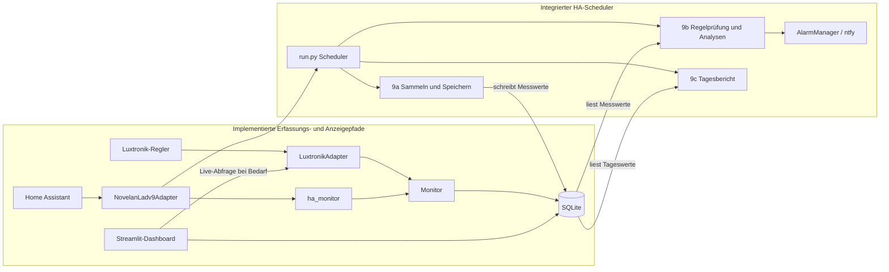

# Backlog – Issues zum Verteilen an Agenten

Jedes Issue ist so geschnitten, dass ein Agent es in einem PR erledigen kann.
**Parallel-Gruppe**: Issues derselben Gruppe berühren keine gemeinsamen Dateien und können gleichzeitig laufen.

Der Status bewertet den **im Repository vorhandenen Implementierungs- und Teststand**,
nicht Installation, Verfügbarkeit oder Betriebsreife eines Live-Systems. „Fertig“ bedeutet
hier: der beschriebene Codepfad ist vorhanden und durch Tests abgedeckt; reale
Regler-/Home-Assistant-Zugriffe und App-Deployment sind damit nicht nachgewiesen.

**Stand: Review und lesende Inventur vom 08.11.2026.** Zielhardware ist ein
Raspberry Pi 5 mit Home Assistant OS und Supervisor-App. Ein SMA Sunny Home Manager
2.0 ist laut Betreiber vorhanden und wurde in evcc als Netzzähler eingerichtet.
Bei der letzten Prüfung nach einer Korrektur zeigte evcc allerdings **keinen
Netzzähler**; Ursache und aktueller Zustand sind erneut zu prüfen. SMA-Messwerte
waren in evcc sichtbar; entsprechende Messentitäten wurden in der geprüften
HA-Zustandsliste noch nicht gefunden. Netzbezug, Hausgesamtverbrauch und WP-Verbrauch
sind unterschiedliche Größen; insbesondere ist ein Gesamtwert keine Grundlage
für eine WP-Arbeitszahl.

Prioritäten der neuen Aufgaben: **P1** verhindert falsche Aussagen oder blockiert
zuverlässige Inbetriebnahme; **P2** vervollständigt den Betrieb; **P3** ist ergänzend.
„Offen“ bezeichnet noch nicht umgesetzte Arbeit, „teilweise“ vorhandene, aber
unvollständige oder nicht ausreichend verifizierte Arbeit.

| # | Titel | Agent | Parallel-Gruppe | Abhängig von | Status und belegte Einschränkung |
|---|---|---|---|---|---|
| 1 | Spreizungs-Analyse | analyst | A | – | **fertig** – `analyse/spreizung.py`, `tests/test_spreizung.py`; Bewertung beruht auf den implementierten Richtwerten. |
| 2 | Adapter für meine Wärmepumpe | datensammler | A | – | **fertig** – Luxtronik- und Novelan/HA-Adapter mit Tests; reale Geräte-/HA-Verbindung nicht durch Tests belegt. Luxtronik liefert nur aktuelle Werte, keine Historie. |
| 3 | Heizstab- und Effizienz-Analyse | analyst | B | 1 | **fertig** – `analyse/effizienz.py`, `tests/test_effizienz.py`; AZ setzt geeignete Energie- und Außentemperaturwerte voraus. |
| 4 | Raumkomfort-Analyse | analyst | C | – | **fertig** – `analyse/komfort.py`, `tests/test_komfort.py`; tatsächliche Raumwerte und Sollwerte müssen bereitgestellt werden. |
| 5 | Simulation: Fehlerszenarien | tester | A | – | **fertig** – Szenarien und Tests in `simulation.py`, `tests/test_simulation.py`; Simulation ist kein Live-Nachweis. |
| 6 | Alarm-Grundgerüst mit Telegram/ntfy | alarm | B | – | **fertig im Code** – ntfy und AlarmManager sind mit dem HA-Scheduler verdrahtet; Telegram fehlt, der Zustand liegt nur im Prozessspeicher. Betriebsfestigkeit siehe 24. |
| 7 | SQLite-Speicher | datensammler | B | 2 | **fertig im Code** – Speicher-API und Persistenztests vorhanden; Live-DB nutzt das relationale Schema. Backup und Wiederherstellung siehe 23. |
| 8 | Tagesbericht | analyst | – | 1, 3, 4 | **fertig** – Berichtsgenerator und Tests vorhanden; Datenqualität und Abdeckung begrenzen die Aussage des Berichts. |
| 9 | Dauerbetrieb (Scheduler: sammeln → analysieren → melden) | architekt → alle | – | 6, 7 | **teilweise** – integrierter Scheduler ist für HA vorhanden; direkter Luxtronik-Pfad und Dauerbetriebsvalidierung sind offen (20, 21, 25). |
| 9a | Sammeln und Speichern orchestrieren | datensammler | D | 2, 7 | **fertig** – `erfassung.py`, `tests/test_erfassung.py`; keine eigene Zeitplanung (wie vorgesehen). |
| 9b | Regelprüfung und Alarmierung orchestrieren | alarm | D | 1, 3, 4, 6, 7 | **fertig im Code** – `monitoring.py` wird vom HA-Scheduler gestartet; Live-Alarmierung nicht nachgewiesen. |
| 9c | Tagesbericht aus dem Speicher erzeugen | analyst | D | 7, 8 | **fertig im Code** – `tageslauf.py` wird vom Scheduler täglich aufgerufen; Live-Dauerbetrieb nicht nachgewiesen. |
| 9d | CLI und Scheduler integrieren | architekt | – | 9a, 9b, 9c | **teilweise** – `run.py` und Tests vorhanden, aktuell mit HA-Adapter; Fehlerbehandlung und direkter Luxtronik-Betrieb siehe 20–21. |
| 10 | Dashboard (Streamlit) | analyst | – | 7 | **fertig im Code** – Live, Simulation, Heißgaskontext und Zeiträume vorhanden; Live-Zugriff geprüft, Dauerbetrieb und HA-Einbindung offen (20, 25–26). |
| 11 | Luxtronik-CSV: Feldinventur und fokussierter Import | datensammler | – | – | **teilweise** – generischer `CsvAdapter` existiert; die geforderte `mappe_luxtronik_csv`-Feldzuordnung (inkl. namenloser Zeitspalte) und CSV-spezifische Tests fehlen. |
| 12 | SQLite-Kernschema für Anlagen und Messwerte | datensammler | – | bestehender SQLite-Speicher | **fertig im Code** – Zieltabellen, Migration und Tests vorhanden; Live-DB hat das relationale Schema. Backup vor künftigen Migrationen siehe 23. |
| 13 | Raumtemperaturen relational speichern | datensammler | – | 12 | **teilweise** – relationale Raumwerte und Tests vorhanden; Schnittstelle weicht vom Issue ab, reale Raumwerte und Sollwerte sind nicht nachgewiesen. |
| 14 | Störungs- und Wartungsereignisse speichern | datensammler | – | 13 | **teilweise** – Speicherung, Bereichsabfragen und Tests vorhanden; die Methoden heißen `speichern_stoerung`/`speichern_wartung_reparatur` statt der im Issue benannten Schnittstellen. Tatsächliche Ereignisdaten und Live-Migration sind nicht nachgewiesen. |
| 15 | CI-Qualitätschecks für Python | tester | – | – | **teilweise / P1** – Workflow vorhanden; `.[dev]` enthält keine Dashboard-Abhängigkeiten für die aktuellen Tests. Frischen CI-Lauf und Pflichtstatus verifizieren. |
| 16 | Test- und CI-Dokumentation vervollständigen | architekt | – | 15 | **teilweise** – Dokumentation vorhanden, aber Statusangaben widersprüchlich; nach 15 berichtigen. |
| 17 | Fehlende Luxtronik-Zustände korrekt behandeln | datensammler | – | – | **offen / P1** – fehlende Laufzeiten werden aktuell als „aus“ abgeleitet. |
| 18 | SMA/evcc-Zuordnung und Stromdaten für HA/WP-Analyse | datensammler | – | – | **teilweise / P1** – SMA-Werte in evcc gesehen; Netzzähler zuletzt fehlend, HA-Messentitäten und WP-Stromquelle nicht nachgewiesen. Nächste Schritte siehe unten. |
| 19 | Arbeitszahl fachlich korrekt auswerten | analyst | – | 18 | **teilweise / P1** – Analyse und Dashboard vorhanden; WP-Stromquelle und belastbare Berechnung fehlen. |
| 20 | Betriebsweg und konkurrierende Reglerabfragen klären | architekt | – | – | **offen / P1** – HA-Scheduler und direkter Luxtronik-Monitor sind getrennte Pfade; Intervallprüfung ist keine Sperre. |
| 21 | Dauerbetrieb und Wiederanlauf absichern | datensammler | – | 20 | **teilweise / P1** – Scheduler und Monitor vorhanden; Fehler- und Wiederanlaufverhalten nicht ausreichend validiert. |
| 22 | Messlücken und Datenqualität sichtbar machen | analyst | – | 17, 21 | **teilweise / P1** – Hinweise vorhanden; zuverlässige Lückenüberwachung und aussagekräftige Bewertungen fehlen. |
| 23 | SQLite-Backup und Wiederherstellung | datensammler | – | – | **offen / P1** – relationales Schema und Integritätsprüfung vorhanden; Backup/Restore praktisch nicht nachgewiesen. |
| 24 | Alarmzustand und Zustellung absichern | alarm | – | 21, 22 | **teilweise / P2** – ntfy und Entprellung vorhanden, Zustände nur im Speicher; Zustell- und Neustartverhalten prüfen. |
| 25 | Zielhardware Raspberry Pi 5 / HA OS validieren | tester | – | 15, 20, 21, 23 | **offen / P1** – App und aarch64-Konfiguration vorhanden; Tests auf Zielhardware nicht nachgewiesen. |
| 26 | Dashboard auf HA-Zielsystem bereitstellen | architekt | – | 20, 25 | **offen / P2** – Streamlit ist derzeit separat und nicht in die HA-App eingebunden. |
| 27 | Luxtronik-Feldsemantik und Grenzwerte validieren | datensammler | – | – | **teilweise / P2** – Rohwerte werden gespeichert; Einheiten, Verfügbarkeit und Herstellergrenzen sind teils ungeprüft. |

Die neuen Issues haben keine Parallel-Gruppe: Eine parallele Bearbeitung ist erst nach
Abgleich der tatsächlich betroffenen Dateien und Schnittstellen festzulegen.

#### Zusammenspiel der Teilbereiche

Durchgezogene Pfeile zeigen implementierte Codepfade; sie belegen keinen validierten
Dauerbetrieb. Der integrierte Scheduler nutzt den HA-Adapter; der direkte Luxtronik-Pfad
ruft diesen Scheduler nicht auf.

#### Live-Verifikation (08.11.2026)

Der Live-Reglerzugriff über das Streamlit-Dashboard wurde am 07.11.2026 erfolgreich
getestet. Bei lesender Prüfung am 08.11.2026 enthielt `data/wp.sqlite` **142 Messungen**, die
relationalen Zieltabellen und 12 Abstände über 90 Sekunden; der größte betrug etwa
12 Stunden 23 Minuten. `integrity_check` ergab `ok`. Die Ursachen der Lücken
sind nicht geklärt. Ein durchgehender oder längerfristiger
Dauerbetrieb ist nicht validiert. Vor künftigen Migrationen ist eine Sicherung nötig;
Backup und Wiederherstellung sind gesondert nachzuweisen (Issue 23).

Lokal bestanden am 08.11.2026 **123 Tests** und `ruff check .`; die bestehende
Umgebung enthält Dashboard-Abhängigkeiten. Das belegt keinen frischen CI-Lauf.

---

### Issue 1 – Spreizungs-Analyse
**Ziel:** `src/wpanalyse/analyse/spreizung.py` mit `analysiere_spreizung(df, cfg) -> SpreizungErgebnis`.
**Akzeptanz:** mittlere Spreizung nur bei laufendem Verdichter; Regel A3 aus `fachwissen.md`; Bewertung + Klartext; Tests für Normalfall und „verschmutzter Filter“.
**Muster:** `analyse/taktung.py`.

### Issue 2 – Adapter für meine Wärmepumpe
**Ziel:** neuer Adapter in `src/wpanalyse/adapters/` für *(Marke/Modell/Schnittstelle eintragen, z. B. Home Assistant REST-API)*.
**Akzeptanz:** implementiert `DatenAdapter`; Zugangsdaten aus Umgebungsvariablen, `.env.example` ergänzt; Mapping der Herstellerfelder auf `fachwissen.md`-Felder dokumentiert; Tests mit gemockten Antworten.

### Issue 3 – Heizstab- und Effizienz-Analyse
**Ziel:** `analyse/effizienz.py` – Tages-AZ, Bewertung abhängig von Außentemperatur (A2), Heizstab-Regel (A4).
**Akzeptanz:** funktioniert auch ohne `waerme_kwh` (dann nur Heizstab-Regel und Hinweis „AZ nicht berechenbar“).

### Issue 4 – Raumkomfort-Analyse
**Ziel:** `analyse/komfort.py` – je Raum Anteil Zeit unter Soll, Regeln A5/A6, kältester Raum, Hinweis auf hydraulischen Abgleich.
**Akzeptanz:** Raum-Sollwerte aus `config.py`; beliebig viele `raum_*_c`-Spalten.

### Issue 5 – Simulation: Fehlerszenarien
**Ziel:** `simulation.py` um Szenarien erweitern: `filter_verschmutzt`, `heizstab_mild`, `raum_kalt`, `datenluecke`, `stoerung`.
**Akzeptanz:** jedes Szenario per Parameter aktivierbar; Tests prüfen, dass das Szenario in den Daten sichtbar ist.

### Issue 6 – Alarm-Grundgerüst
**Ziel:** `src/wpanalyse/alarm/` mit `Melder`-Interface, `NtfyMelder` und/oder `TelegramMelder`, Entprellung (gleiche Meldung max. 1×/6 h), Entwarnung.
**Akzeptanz:** Tests mit `FakeMelder`.

### Issue 7 – SQLite-Speicher
**Ziel:** `src/wpanalyse/speicher/` – Messwerte speichern/laden als DataFrame für Zeitraum.

### Issue 8 – Tagesbericht
**Ziel:** Text/Markdown-Bericht: AZ, Starts, Laufzeit, Spreizung, Komfort je Raum, Auffälligkeiten – verständlich für Laien.

### Issue 9 – Dauerbetrieb
**Ziel:** Kommando `python -m wpanalyse.run`: alle X Minuten sammeln, alle 15 min Regeln prüfen und täglich einen Bericht erzeugen. Das Issue ist in 9a–9d zerlegt; 9a–9c können parallel bearbeitet werden. Docker-Betrieb (z. B. auf Raspberry Pi / NAS) bleibt späteren Issues vorbehalten.

#### Teil-Issue 9a – Sammeln und Speichern orchestrieren
**Agent:** datensammler
**Ziel:** Adapter und Speicher für einen Sammellauf verbinden, ohne den Scheduler vorwegzunehmen.
**Betroffene Dateien:** `src/wpanalyse/erfassung.py`, `tests/test_erfassung.py`.
**Schnittstelle:** `sammle_und_speichere(adapter: DatenAdapter, speicher: SQLiteSpeicher, von: datetime, bis: datetime) -> pd.DataFrame`.
**Akzeptanzkriterien:**
- Ruft den Adapter für den halboffenen Zeitraum `[von, bis)` auf und speichert das Ergebnis unverändert im Speicher.
- Gibt die gesammelten Messwerte zurück, damit Aufrufer den Lauf nachvollziehen können.
- Adapter- und Speicherfehler werden nicht verschluckt oder als erfolgreicher Lauf ausgegeben.
- Die Funktion enthält keine eigene Zeitplanung.
**Testidee:** Mit Fake-Adapter und SQLite-Testdaten prüfen, dass Zeitraum, zurückgegebener DataFrame und gespeicherte Messwerte übereinstimmen; Fehler des Adapters werden weitergereicht.

#### Teil-Issue 9b – Regelprüfung und Alarmierung orchestrieren
**Agent:** alarm
**Ziel:** Gespeicherte Messwerte durch die bestehenden Analysen führen und den vollständigen Befundstand an den Alarmmanager übergeben.
**Betroffene Dateien:** `src/wpanalyse/monitoring.py`, `tests/test_monitoring.py`.
**Schnittstelle:** `pruefe_und_melde(speicher: SQLiteSpeicher, alarm_manager: AlarmManager, cfg: Config, von: datetime, bis: datetime) -> list[Befund]`.
**Akzeptanzkriterien:**
- Liest den angefragten Zeitraum und führt Taktungs-, Effizienz-, Spreizungs- und Komfortanalyse aus.
- Übergibt alle aktuellen Befunde gesammelt genau einmal an `AlarmManager.verarbeite`, auch wenn die Liste leer ist, damit Entwarnungen funktionieren.
- Fehlende optionale Messwertfelder erzeugen keinen unbehandelten `KeyError`; nicht auswertbare Regeln werden kenntlich gemacht und lösen keine falsche Entwarnung aus.
- Enthält keine eigene Zeitplanung und versendet selbst keine Meldungen am Alarmmanager vorbei.
**Testidee:** Fake-Speicher und Fake-Alarmmanager prüfen gelesenen Zeitraum, zusammengeführte Befunde sowie den Aufruf mit leerem Befundstand.

#### Teil-Issue 9c – Tagesbericht aus dem Speicher erzeugen
**Agent:** analyst
**Ziel:** Tagesdaten laden, mit dem bestehenden Berichtsgenerator formatieren und den Bericht als Datei ablegen.
**Betroffene Dateien:** `src/wpanalyse/tageslauf.py`, `tests/test_tageslauf.py`.
**Schnittstelle:** `erzeuge_tagesbericht(speicher: SQLiteSpeicher, cfg: Config, tag: date, ziel: Path) -> Path`.
**Akzeptanzkriterien:**
- Liest den gewählten Kalendertag als halboffenen UTC-Zeitraum `[00:00, Folgetag 00:00)` und verwendet `erstelle_tagesbericht`.
- Schreibt den Markdown-Bericht unter `ziel` und gibt den verwendeten Dateipfad zurück.
- Ein Tag ohne Messwerte erzeugt den bereits vorgesehenen verständlichen Leerbericht.
- Datei- und Speicherfehler werden nicht verschluckt.
**Testidee:** Mit SQLite und temporärem Verzeichnis einen Bericht mit sowie ohne Messwerte erzeugen und Inhalt, Datum und Rückgabepfad prüfen.

#### Teil-Issue 9d – CLI und Scheduler integrieren
**Agent:** architekt
**Ziel:** Die Teilfunktionen als startbaren Dauerbetrieb unter `python -m wpanalyse.run` verbinden.
**Betroffene Dateien:** `src/wpanalyse/run.py`, `tests/test_run.py`, `docs/architektur.md`.
**Schnittstelle:** `main(argv: Sequence[str] | None = None) -> int`; interne Abhängigkeiten für Adapter, Speicher, Alarmmanager, Uhr und Laufaktionen müssen für Tests austauschbar sein.
**Akzeptanzkriterien:**
- Bietet ein konfigurierbares Sammelintervall (X Minuten), prüft Regeln alle 15 Minuten und erzeugt täglich einen Bericht.
- Verwendet die Teilfunktionen 9a–9c; Logik für Sammeln, Analysieren und Berichtserzeugung wird nicht dupliziert.
- Unterstützt geordnetes Beenden, z. B. mit Strg+C, und lässt Fehler eines Laufs sichtbar werden, ohne den Erfolg dieses Laufs vorzutäuschen.
- Dokumentiert Start, Konfiguration und den Laufzeit-Datenfluss in `docs/architektur.md`.
- Startet über `python -m wpanalyse.run`; Tests benötigen weder echte API-Zugangsdaten noch Wartezeiten.
**Testidee:** Scheduler mit kontrollierter Uhr und Fake-Laufaktionen prüfen, dass Sammel-, Prüf- und Tagesberichtsläufe zu den vorgesehenen Intervallen ausgelöst werden; zusätzlich CLI-Start und geordnetes Beenden testen.

### Issue 10 – Dashboard
**Ziel:** Streamlit-App mit Verläufen (Vorlauf/Rücklauf/Außen, Leistung, Starts/Tag, AZ über Außentemperatur).

### Issue 11 – Luxtronik-CSV: Feldinventur und fokussierter Import
**Befund aus Issue #39:** Der angehängte Export enthält fünf Messpunkte im Abstand von etwa einer Minute. Damit ist eine Feldinventur möglich, aber keine belastbare Tagesbewertung oder Defektvorhersage. Für den ersten Monitoring-Schritt sind Zeitstempel, `aussen_c`, `vorlauf_c`, `ruecklauf_c`, `betriebsart`, `verdichter_an`, `heizstab_an` und der Startzähler `verdichter_starts_zaehler` relevant. `waerme_w` ist eine Wärmeleistung, keine Wärmeenergie; eine explizite elektrische Energie (`strom_kwh`) ist im Export nicht erkennbar. `lux_ID_WEB_WMZ_Heizung`, `lux_ID_WEB_WMZ_Brauchwasser` und Laufzeit-/Abtauungsfelder erst nach Klärung von Einheit, Zählerverhalten und Messbedeutung verwenden. Fehlernummern benötigen eine Fehlercode-Tabelle. Raumkomfort ist mit einem möglichen zentralen RBE-Ist-/Sollwert nicht raumweise belegt.

**Ziel:** Den Export auf bestätigte Projektfelder abbilden, statt sämtliche herstellerspezifischen Rohspalten in Analysen einzuspeisen.
**Agent:** datensammler
**Betroffene Dateien:** `src/wpanalyse/adapters/csv_adapter.py`, `src/wpanalyse/config.py`, `tests/` (CSV-Adaptertests).
**Schnittstelle:** `mappe_luxtronik_csv(df: pd.DataFrame) -> pd.DataFrame`.
**Akzeptanzkriterien:**
- Erkennt den Zeitstempel der Exportdatei auch dann, wenn die erste CSV-Spalte keinen Spaltennamen hat, und liefert einen UTC-`DatetimeIndex`.
- Bildet nur Felder mit bestätigter Bedeutung auf Projektfeldnamen ab; für den Start genügen die oben genannten Basisfelder.
- Erzeugt weder `leistung_w`/`strom_kwh` noch `waerme_kwh` aus nicht bestätigten Exportfeldern. Eine Effizienzbewertung bleibt ohne validierte Wärme- und Stromenergie nicht auswertbar.
- Unbekannte Herstellerfelder werden nicht als Analysefelder interpretiert; `verdichter_starts_zaehler` wird für Taktungskennzahlen nur über Zählerdifferenzen einer ausreichend langen Zeitreihe ausgewertet.
**Testidee:** Synthetische CSV mit leerer Zeitspaltenüberschrift, zwei UTC-Zeitpunkten, bekannten Basisfeldern sowie unbekannten/ungeklärten Spalten einlesen; Zeitindex, Mapping, Ausschluss unbestätigter Kennzahlen und fehlende Werte prüfen.

**Nicht Teil dieses Issues:** Effizienzbewertung, Reparaturempfehlungen und Defektvorhersage aus dem kurzen Ausschnitt ableiten. Die Effizienzanalyse benötigt bestätigte Wärme- und Stromenergie; Verbesserungs- und Reparaturhinweise benötigen längere Verläufe und geklärte Feldsemantik; Defektvorhersage zusätzlich historische, bestätigte Ausfall- oder Reparaturereignisse.

### Issue 12 – SQLite-Kernschema für Anlagen und Messwerte
**Ziel:** Das bisherige JSON-Zeilenformat des SQLite-Speichers auf das Zielschema `anlage` und `messwert` aus `docs/architektur.md` umstellen, ohne bestehende Messdaten oder die DataFrame-Schnittstelle zu verlieren.
**Agent:** datensammler
**Betroffene Dateien:** `src/wpanalyse/speicher/sqlite.py`, `tests/test_sqlite_speicher.py`.
**Schnittstelle:** `SQLiteSpeicher(pfad: str | Path, anlage_id: str = "standard")`; `speichern(df: pd.DataFrame) -> None`; `lese(von: datetime, bis: datetime) -> pd.DataFrame`.
**Akzeptanzkriterien:**
- Legt die Anlagen- und Messwerttabellen nach dem Feld- und Typvertrag in `docs/architektur.md` an; pro Anlage und UTC-Zeitpunkt gibt es höchstens einen Messwert.
- Alle Messwertspalten außer Anlagen-ID und Zeitstempel sind nullable; Boolesche Werte werden konsistent als `0`/`1` gespeichert und gelesen.
- `strom_kwh` und `waerme_kwh` sind Intervallenergien; bestätigte kumulative Energiezähler und Verdichterlaufzeiten werden nur in den dafür vorgesehenen getrennten Zähler-/Intervallfeldern gespeichert. Nicht zugeordnete Eingabespalten bleiben in `rohfelder_json` erhalten und werden nicht als Analysefelder ausgegeben.
- Migration des bisherigen `messwerte(zeit_ns, daten)`-Formats bewahrt alle Zeilen: bekannte Felder werden typisiert, andere Felder bleiben in den Rohfeldern; sie werden der Anlagen-ID `standard` zugewiesen.
- UTC-Normalisierung, halboffene Zeitraumabfrage, leere DataFrames mit Spaltennamen und Aktualisierung doppelter Zeitstempel bleiben unterstützt.
- Schreib-/Lesevorgänge für zwei unterschiedliche Anlagen mit demselben Zeitpunkt bleiben voneinander getrennt.
**Testidee:** Bestehende Persistenztests erweitern um Migration eines alten JSON-Datensatzes, nullable Werte, Rohfeld-Rundlauf, Intervallenergien, zwei Anlagen am selben Zeitpunkt und bestehende UTC-/Zeitraumsemantik.

### Issue 13 – Raumtemperaturen relational speichern
**Ziel:** Raumwerte aus `raum_<name>_c`-Eingabespalten in die Tabelle `raum_messwert` aus `docs/architektur.md` normalisieren.
**Agent:** datensammler
**Betroffene Dateien:** `src/wpanalyse/speicher/sqlite.py`, `tests/test_sqlite_speicher.py`.
**Schnittstelle:** `SQLiteSpeicher.speichere_raeume(df: pd.DataFrame, sollwerte_c: Mapping[str, float] | None = None) -> None`; `SQLiteSpeicher.lese_raeume(von: datetime, bis: datetime) -> pd.DataFrame`.
**Abhängigkeit:** Issue 12.
**Akzeptanzkriterien:**
- Speichert je Anlage, Zeitpunkt und Raum eine Zeile mit Isttemperatur und optionalem zu diesem Zeitpunkt gültigem Sollwert.
- Unterstützt beliebig viele Räume ohne dynamische SQL-Spalten; fehlende Ist- oder Sollwerte werden nicht erfunden.
- UTC-Zeitstempel sowie Schlüssel und Nullable-Regeln entsprechen `docs/architektur.md`.
- Bestehende Messwertspalten und Speicherabfragen bleiben unverändert.
**Testidee:** Synthetische Zeitreihe mit zwei Räumen und wechselnden Sollwerten speichern und zeilenweise einschließlich fehlender Werte und UTC-Zeitstempeln wieder auslesen.

### Issue 14 – Störungs- und Wartungsereignisse speichern
**Ziel:** Roh gemeldete Störungen sowie dokumentierte Wartungs-/Reparaturfälle getrennt in den Tabellen `stoerung` und `wartung_reparatur` persistieren.
**Agent:** datensammler
**Betroffene Dateien:** `src/wpanalyse/speicher/sqlite.py`, `tests/test_sqlite_speicher.py`.
**Schnittstelle:** `speichere_stoerung(ereignis: Stoerung) -> None`; `speichere_wartung(ereignis: WartungReparatur) -> None`; Zeitraum-Leseoperationen für beide Ereignistypen.
**Abhängigkeit:** Issue 13.
**Akzeptanzkriterien:**
- Feldnamen, Zeitspalten und Nullbarkeit entsprechen `docs/architektur.md`; Ereignisse sind einer bestehenden Anlage zugeordnet.
- Fehlercodes und Rohbeschreibungen bleiben unverändert erhalten; unbekannte Codes werden nicht automatisch diagnostiziert.
- Wartungsfälle enthalten dokumentierte Maßnahme und optional einen bestätigten Fehler getrennt von einer bloßen Störung.
- Ereignisse sind über stabile IDs idempotent speicherbar und anhand Anlage/Zeitbereich abfragbar.
**Testidee:** Je ein Störungs- und Wartungsereignis mit fehlenden optionalen Feldern speichern, erneut laden und unveränderte Codes, Texte, Zeitstempel und Anlagenzuordnung prüfen.

### Issue 15 – CI-Qualitätschecks für Python
**Ziel:** Bestehende Projektchecks für Lint und Tests automatisiert als Qualitäts-Gate ausführen.
**Agent:** tester
**Betroffene Dateien:** `.github/workflows/quality-checks.yaml`.
**Schnittstelle:** GitHub-Actions-Workflow; keine Python-Schnittstelle.
**Akzeptanzkriterien:**
- Läuft für alle Pull Requests und Pushes auf `main`, damit Änderungen an Tests oder Konfiguration die Checks nicht durch Pfadfilter überspringen.
- Installiert das Projekt samt allen für die Tests benötigten Entwicklungs- und Dashboard-Abhängigkeiten in einer frischen Umgebung und führt `ruff check .` sowie `pytest` aus.
- Prüft mindestens die unterstützte Mindestversion Python 3.11; Umgebungszugangsdaten und Netzwerkzugriff auf Wärmepumpen/Home Assistant sind nicht erforderlich.
- Bleibt vom Workflow `.github/workflows/build-app.yaml` getrennt: dieser baut/veröffentlicht das Home-Assistant-Image, die neuen Jobs prüfen Codequalität.
**Testidee:** Workflow-Lauf für einen Pull Request mit grünen Checks prüfen; danach lokal in einem Test-Branch jeweils einen Ruff-Fehler und einen fehlschlagenden Test einführen und sicherstellen, dass der zugehörige Job fehlschlägt. Keine Fehleränderung in den Hauptbranch übernehmen.

### Issue 16 – Test- und CI-Dokumentation vervollständigen
**Ziel:** Das Testkonzept und die tatsächlich aktiven CI-Prüfungen nach Umsetzung von Issue 15 nachvollziehbar dokumentieren.
**Agent:** architekt
**Betroffene Dateien:** `docs/architektur.md`, `README.md`.
**Schnittstelle:** Keine Code-Schnittstelle.
**Abhängigkeit:** Issue 15.
**Akzeptanzkriterien:**
- Beschreibt Testebenen und Grenzen (synthetische Daten/Fakes statt Live-Nachweis), lokale Installations- und Prüfkommandos sowie Workflow-Trigger und Jobs anhand der implementierten Konfiguration.
- Erklärt, welche Statusprüfung vor Merge erforderlich ist und dass der Image-Build kein Ersatz für Test-/Lint-Ergebnisse ist.
- Trennt umgesetzte Prüfungen klar von manuellen Live-/Deployment-Prüfungen und entfernt veraltete Aussagen über den Workflow-Status.
**Testidee:** Dokumentierte Befehle mit `pyproject.toml` und Workflow vergleichen; Pfade und Workflow-Namen gegen die tatsächlich vorhandenen Dateien prüfen.

---

### Issue 17 – Fehlende Luxtronik-Zustände korrekt behandeln
**Status/Priorität:** offen / P1. **Agent:** datensammler. **Abhängigkeit:** keine.
**Ziel:** Fehlende oder ungültige Laufzeitsignale dürfen nicht als ausgeschalteter Verdichter bzw. Heizstab gelten.
**Betroffene Dateien:** `src/wpanalyse/adapters/luxtronik.py`, zugehörige Adapter- und Dashboardtests; betroffene Auswertungen nach Bedarf.
**Schnittstelle:** Bestehende Felder `verdichter_an` und `heizstab_an` bleiben nullable.
**Akzeptanz:** Vorhandene gültige Signale ergeben den bestätigten Zustand; fehlende oder ungültige Signale bleiben unbekannt. Bei mehreren Heizstufen wird ein unbekannter Gesamtzustand nur dann als aus gewertet, wenn alle dafür nötigen Signale aus sind. Dashboard, Speicherung und Analysen unterscheiden unbekannt von aus.
**Testidee:** Synthetische Fälle für an, aus, fehlend, ungültig und gemischte Heizstufensignale einschließlich Speicher-Rundlauf und Anzeige prüfen.

### Issue 18 – SMA-Stromquelle und Messbedeutung klären
**Status/Priorität:** teilweise / P1. **Agent:** datensammler. **Abhängigkeit:** keine.
**Ziel:** Sunny Home Manager und PV-Zähler in evcc korrekt zuordnen und bestätigte
Energiedaten als getrennten Kontext nach HA und WP-Analyse bringen.

**Inventurstand vom 08.11.2026:** Vor der Korrektur zeigten Netz- und Solarzähler
identische Werte; beide Einträge verwendeten dieselbe Geräteadresse, aber unterschiedliche
Gerätetypen. Der Betreiber hat danach eine Korrektur vorgenommen; eine erfolgreiche
Neuzuordnung wurde noch nicht nachgewiesen. Beim letzten Aktualisieren zeigte evcc
unter „Grid“ nur „Add grid meter“; unter „Solar & battery“ waren weiterhin ein
Solarzähler und ein Batteriespeicher aufgeführt. In den geprüften HA-Zuständen wurden
keine SMA-/evcc-Messentitäten gefunden, nur eine evcc-Update-Entität. Das evcc-Add-on
allein belegt nicht, dass die Messwerte als HA-Entitäten verfügbar sind.

**Nächste Schritte, alle P1:**
1. **Offen – evcc-Netzzähler prüfen:** Konfiguration erneut öffnen; falls weiterhin
   fehlend, Sunny Home Manager 2.0 als Netzzähler einrichten. Leistungsrichtung,
   Netzbezug und Einspeisung anhand zuverlässiger Referenzwerte prüfen.
2. **Offen – Solarzuordnung prüfen:** Tatsächlichen Wechselrichter und dessen Adresse
   anhand Router-/SMA-Geräteübersicht identifizieren; unabhängig vom Netzzähler als
   PV-Quelle zuordnen. PV-Leistung und Zählerwerte mit der SMA-Anzeige vergleichen;
   ggf. auch Batteriezuordnung prüfen. Keine Gerätedaten oder Zugangsdaten einchecken.
3. **Offen – HA-Anbindung auswählen und einrichten:** Vorzugsweise
   [ha-evcc über HACS](https://docs.evcc.io/en/smarthome/home-assistant/) prüfen;
   REST/MQTT sind Alternativen. Installation und eventuellen HA-Neustart mit dem
   Betreiber abstimmen. MQTT war bei der Inventur in evcc nicht konfiguriert. Die
   offizielle SMA-Solar-Integration unterstützt den Sunny Home Manager laut ihrer
   [Dokumentation](https://www.home-assistant.io/integrations/sma/) nicht direkt.
4. **Offen – Entitäten inventarisieren:** Nach der Anbindung tatsächliche Entity-IDs,
   Messpunkt, Einheit, Vorzeichen, Aktualisierung und Zählersemantik von Netzbezug,
   Einspeisung, PV und Batterie prüfen. `unknown`/`unavailable` und veraltete
   Daten berücksichtigen; Wertvergleich mit evcc und SMA durchführen.
5. **Offen – WP-Analyse anbinden:** Datenfluss und zeitliche Zuordnung mit Issue 20
   abstimmen. Netz-, PV- und Batteriegrößen als eigenständige Kontextfelder speichern
   und visualisieren, nicht als elektrische WP-Leistung oder WP-Energie.
6. **Offen – WP-Strommessung klären:** Vorhandensein bzw. Nachrüstung eines separaten
   WP-Zählers und bestätigter Wärmemengenwerte prüfen. Bis dahin keine belastbare
   WP-Arbeitszahl aus Gesamt-/Netzstrom ableiten (Issue 19).

**Betroffene Dateien:** HA-/Adapterdokumentation, Architektur und gegebenenfalls
Adapter, Speicher, Dashboard und Tests; Implementierung erst nach bestätigter
Feldsemantik und Architekturentscheidung.
**Schnittstelle:** Je Signal Quelle, Entity-ID, Messpunkt, Größe, Einheit, Vorzeichen,
Aktualität und Energiezählertyp festhalten; WP-Felder bleiben getrennt.
**Akzeptanz:** Netzbezug, Einspeisung, Hausverbrauch, PV-Erzeugung und etwaige separate
WP-Messung nicht verwechseln; bei fehlender Quelle keine Werte erfinden. Korrekte
Zuordnung in evcc und HA anhand realer Werte verifiziert; Anzeige und Speicherung
von WP-Analyse durch synthetische Tests und einen kontrollierten Live-Vergleich belegt.
**Testidee:** Inventur mit realen HA-Metadaten und anonymisierten Beispielen; Mapping,
fehlende oder veraltete Werte sowie Synchronisation synthetisch testen. Änderung an
Live-Konfiguration erst nach Abstimmung mit dem Betreiber.

### Issue 19 – Arbeitszahl fachlich korrekt auswerten
**Status/Priorität:** teilweise / P1. **Agent:** analyst. **Abhängigkeit:** 18; eine tatsächliche WP-Stromquelle ist Voraussetzung für eine belastbare WP-AZ.
**Ziel:** Arbeitszahl ausschließlich aus geeigneter WP-Strom- und Wärmeenergie im gleichen Zeitraum ermitteln.
**Betroffene Dateien:** `src/wpanalyse/dashboard.py`, `src/wpanalyse/analyse/effizienz.py`, Berichte, Tests und Dokumentation.
**Schnittstelle:** Bestehende Energie- und Leistungsfelder mit bestätigter Einheit und Herkunft; Gesamtstrom nie als WP-Strom interpretieren.
**Akzeptanz:** Intervallenergien und kumulative Zähler getrennt behandeln; Zählerwechsel, Rücksetzung, Lücken und nicht synchrone Werte berücksichtigen. Leistungsintegration nur mit geeigneter Zeitgewichtung und ausgewiesener Abdeckung. Ohne ausreichende WP-Energie „nicht auswertbar“ anzeigen, keine Scheingenauigkeit oder Warnung aus unzureichenden Daten.
**Testidee:** Synthetische gleichmäßige und unregelmäßige Reihen, Zählerdifferenzen/-rücksetzung, Lücken, fehlender WP-Zähler und Hausgesamtstrom.

### Issue 20 – Betriebsweg und konkurrierende Reglerabfragen klären
**Status/Priorität:** offen / P1. **Agent:** architekt. **Abhängigkeit:** keine.
**Ziel:** Einen eindeutigen Betriebs- und Datenfluss für HA OS, direkten Luxtronik-Zugriff und Dashboard festlegen.
**Betroffene Dateien:** `docs/architektur.md`, `docs/luxtronik-anbindung.md`, gegebenenfalls Scheduler, App und Dashboard.
**Schnittstelle:** Entscheidung für Datenquelle, Zuständigkeit für Sammlung und Zugriff auf gespeicherte Werte; direkte Luxtronik-Abfrage und HA-Pfad explizit unterscheiden.
**Akzeptanz:** Nur ein definierter Sammler pro Regler bzw. eine wirksame prozessübergreifende Koordination; Überprüfung und Abfrage dürfen nicht als atomar angenommen werden. Dashboard darf den Sammler nicht ungewollt verdoppeln. Umfang der Integration von Analyse, Alarm und Bericht beschreiben; Dokumentationsaussage über angeblich ausgeschlossene Doppelabfragen berichtigen.
**Testidee:** Zwei konkurrierende Aufrufer und Kombination aus Monitor und Dashboard simulieren; reale Inbetriebnahme erst nach Architekturentscheidung.

### Issue 21 – Dauerbetrieb und Wiederanlauf absichern
**Status/Priorität:** teilweise / P1. **Agent:** datensammler. **Abhängigkeit:** 20.
**Ziel:** Störungen von Datenquelle, Speicher und Meldekanal im gewählten Betriebsweg beherrschbar machen.
**Betroffene Dateien:** `src/wpanalyse/run.py`, Erfassung/Monitor, App-Konfiguration, Tests und Betriebsdokumentation.
**Schnittstelle:** Verhalten bei temporären und dauerhaften Fehlern, Retry/Backoff und Wiederanlauf explizit festlegen.
**Akzeptanz:** Fehler sichtbar melden; keine Erfolgsmeldung bei fehlgeschlagenem Lauf. Unterbrechungen führen nicht zu stillen Datenverlusten; Wiederanlaufverhalten und nicht nachholbare Daten sind dokumentiert. Geordnetes Beenden und Wiederaufnahme prüfen; externe Neustartmechanismen nicht ungeprüft voraussetzen.
**Testidee:** Adapter-, DB- und Netzwerkfehler sowie Neustart mit kontrollierter Uhr und temporärer DB testen; Zielhardwaretest anschließend im Rahmen von 25.

### Issue 22 – Messlücken und Datenqualität sichtbar machen
**Status/Priorität:** teilweise / P1. **Agent:** analyst. **Abhängigkeit:** 17, 21.
**Ziel:** Datenabdeckung und veraltete oder fehlende Werte sichtbar machen und Fehlbewertungen vermeiden.
**Betroffene Dateien:** Dashboard, Analysen, Monitoring, Bericht und Tests.
**Schnittstelle:** Konfigurierbare erwartete Abtastung und begründete Schwellen für Lücken und Abdeckung.
**Akzeptanz:** Letzte Messung, Lücken und Teilzeiträume erkennbar darstellen; bei fehlender Abdeckung keine vollständige Messreihe suggerieren. Fehlende Zustände nicht als aus behandeln; Starts und Laufzeiten nicht unbesehen über Lücken extrapolieren. Ein Prozessstillstand benötigt eine davon unabhängige Überwachung; deren Zuständigkeit festlegen.
**Testidee:** Reihen mit längeren Ausfällen, Einzelwerten und unbekanntem Status für Anzeige, Auswertung und Meldung testen.

### Issue 23 – SQLite-Backup und Wiederherstellung
**Status/Priorität:** offen / P1. **Agent:** datensammler. **Abhängigkeit:** keine.
**Ziel:** Ein reproduzierbares Sicherungs- und Wiederherstellungsverfahren für die persistente Datenbank festlegen und erproben.
**Betroffene Dateien:** Betriebsdokumentation, gegebenenfalls Backup-Werkzeuge und Tests.
**Schnittstelle:** Sicherungskopie inklusive konsistentem Umgang mit laufenden SQLite-Schreibvorgängen und gegebenenfalls WAL-Dateien.
**Akzeptanz:** Backup vor Migrationen; Wiederherstellung in separatem Ziel inklusive Integritätsprüfung und Vergleich von Schema und Messwerten nachgewiesen. HA-Supervisor-Backup, Speicherort, Aufbewahrung und Verantwortung für Restore auf Zielsystem prüfen, nicht voraussetzen.
**Testidee:** Temporäre DB während realistischer Schreibaktivität sichern und getrennt wiederherstellen; Live-Datei für Tests nicht verändern.

### Issue 24 – Alarmzustand und Zustellung absichern
**Status/Priorität:** teilweise / P2. **Agent:** alarm. **Abhängigkeit:** 21, 22.
**Ziel:** Zustellung, Entprellung und Entwarnungen auch bei Ausfällen und Neustarts nachvollziehbar gestalten.
**Betroffene Dateien:** `src/wpanalyse/alarm/`, `src/wpanalyse/monitoring.py`, Tests und Betriebsdokumentation.
**Schnittstelle:** Persistenz- und Wiederholungsstrategie einschließlich Fehler- und unbekanntem Datenzustand festlegen.
**Akzeptanz:** Fehlgeschlagene Zustellungen sichtbar; kein unbegründetes „behoben“ bei fehlenden Messwerten. Wiederholungen und Neustartverhalten sind definiert und getestet. Ausfall des gesamten Sammelprozesses kann nicht allein von diesem Prozess gemeldet werden; externe Überwachung klären.
**Testidee:** Fake-Melder mit Zustellfehler, Wiederherstellung, Neustart und Datenlücke; Live-ntfy separat prüfen.

### Issue 25 – Zielhardware Raspberry Pi 5 mit Home Assistant OS validieren
**Status/Priorität:** offen / P1. **Agent:** tester. **Abhängigkeit:** 15, 20, 21, 23.
**Ziel:** Den gewählten Betriebsweg auf einem Raspberry Pi 5 mit Home Assistant OS und Supervisor praktisch abnehmen.
**Betroffene Dateien:** `docs/home-assistant-betrieb.md` und gegebenenfalls App- oder Testdateien.
**Schnittstelle:** Versionen von HA OS, Supervisor, App/Image und Architektur sowie Testzeitraum dokumentieren.
**Akzeptanz:** aarch64-Image bereitstellen, Installation, Konfiguration, Datenfluss und Logs prüfen; Neustart von App und Host, Update, Persistenz und Restore nachweisen. Ausfall und Wiederherstellung der Datenquelle testen; Messabdeckung über einen vereinbarten längeren Testzeitraum dokumentieren. Freigabe erst anhand der Ergebnisse.
**Testidee:** Wiederholbare Checkliste mit Zeitpunkten, erwarteten und tatsächlichen Ergebnissen; keine Zugangsdaten protokollieren.

### Issue 26 – Dashboard auf HA-Zielsystem bereitstellen
**Status/Priorität:** offen / P2. **Agent:** architekt. **Abhängigkeit:** 20, 25.
**Ziel:** Klären und umsetzen, wie das bestehende Streamlit-Dashboard auf dem Zielsystem erreichbar ist.
**Betroffene Dateien:** Architektur-/Betriebsdokumentation und nach Entscheidung App-Konfiguration und Dashboard.
**Schnittstelle:** Zugang, Authentifizierung, Datenbankzugriff und Verhältnis zum Sammler vor Umsetzung festlegen.
**Akzeptanz:** Gewählten Bereitstellungsweg und dessen Sicherheits-/Ressourcengrenzen dokumentieren; keine zusätzlichen unkoordinierten Reglerabfragen. Historie, Zeitauswahl und Logs auf Zielhardware geprüft. Derzeit ist das Dashboard separat, nicht Bestandteil der HA-App.
**Testidee:** Installations- und Zugriffstest auf Zielhardware sowie gleichzeitige Anzeige bei laufender Erfassung.

### Issue 27 – Luxtronik-Feldsemantik und Grenzwerte validieren
**Status/Priorität:** teilweise / P2. **Agent:** datensammler. **Abhängigkeit:** keine.
**Ziel:** Für relevante Rohfelder, Sensoren und Richtwerte belastbare Bedeutung und Eignung klären.
**Betroffene Dateien:** `src/wpanalyse/config.py`, Adapter- und Fachwissen-Dokumentation, Tests.
**Schnittstelle:** Pro Feld Quelle, Einheit, gültiger Bereich, Sensorverfügbarkeit und bestätigtes Zählerverhalten festhalten.
**Akzeptanz:** Unbekannte oder nicht vorhandene Sensoren bleiben als solche kenntlich; keine unbelegten Herstellergrenzen oder Defektdiagnosen. Laufzeit- und Zustandsfelder sowie Heißgas im Betriebskontext mit passenden Unterlagen und Live-Beobachtungen abgleichen.
**Testidee:** Dokumentierte Referenzwerte und synthetische fehlende/ungültige Sensorwerte gegen Mapping und Anzeige prüfen.
